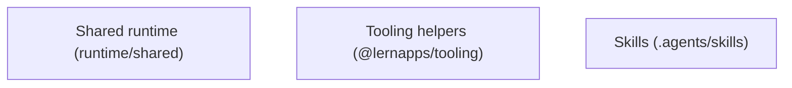
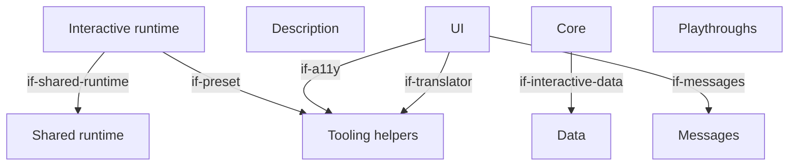
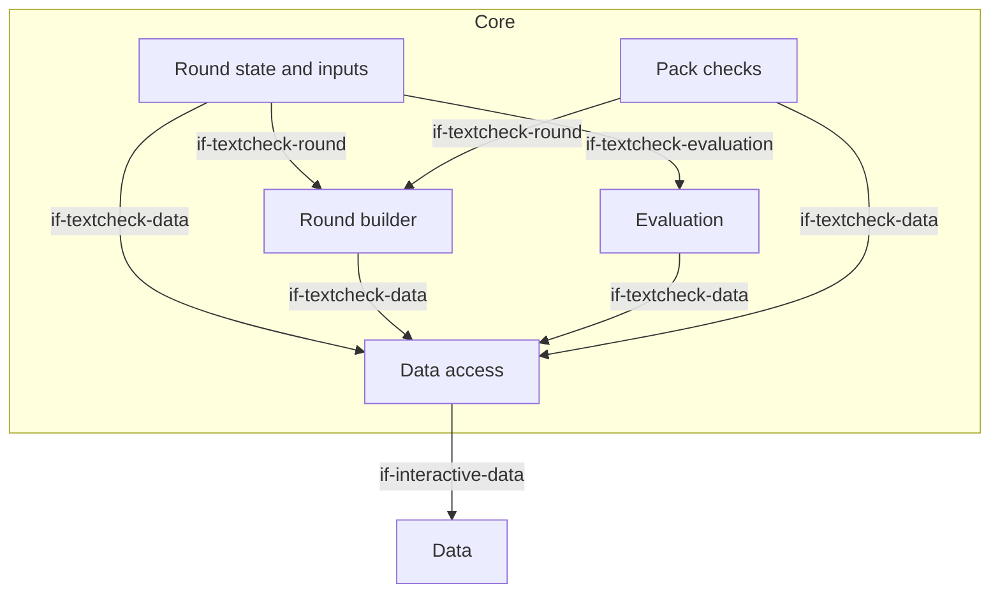
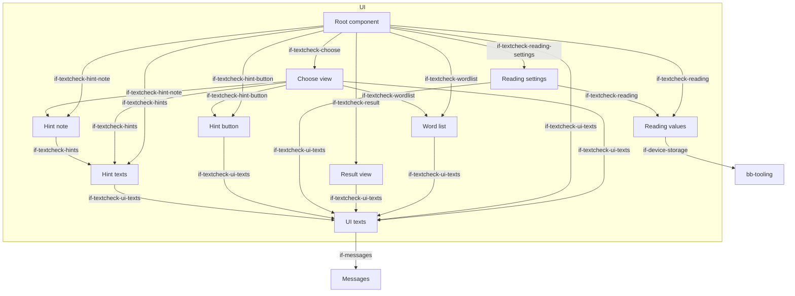
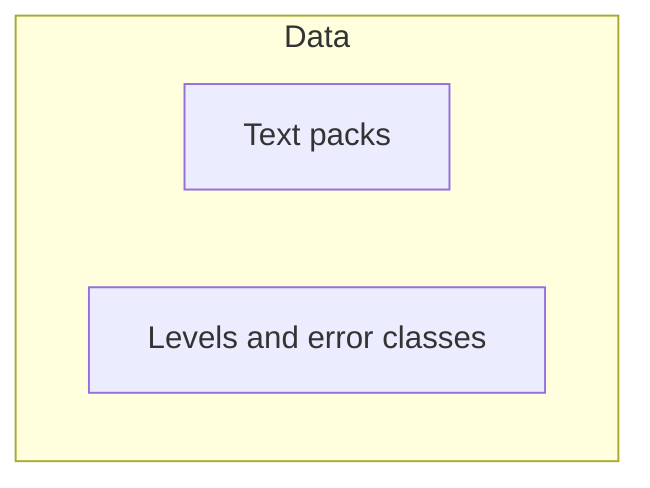

# Building Blocks

<!-- From @lernapps/app-templates f28d020 (the generic part and the interactive extension): lernapps update replaces this file except the app sections, between <!-- app: begin … --> and <!-- app: end … -->, which hold the app's own architecture. -->

The generic part has three roots that every app shares, whatever its archetype: the shared runtime of
`@lernapps/app-templates`, the tooling helpers of `@lernapps/tooling` and the skills the app commits. Each archetype's extension adds the rest of
level 1 (`quiz/docs/arc42/`, `explainer/docs/arc42/`, `interactive/docs/arc42/`): its runtime `bb-archetype-runtime`
with the parts `bb-build`, `bb-validation`, `bb-render`, `bb-shell`, `bb-e2e` and `bb-runtime-texts`, which every
extension defines under these ids, and the parts the creator writes, one of which provides `if-archetype-content`.
Parts that only some archetypes have (component rules, question types, tutor handoff, task numbers, exercise contract)
are in the extensions that use them. Not built and not in the frame now: a loading indicator (`dec-no-size-limit`) and
a settings dialog (`dec-no-settings`).

Paths are relative to the root of `lernapps/app-templates`. The parts in a template folder carry their path with the
folder as prefix (`interactive/src/core`); an app that gets this architecture as a copy has them without it
(`src/core`). An app's architecture is this part followed by its archetype's extension, chapter by chapter; so the
level-1 view of a whole app is in its extension.

## Level 1: the generic roots

```arc42
:::diagram
id: building-blocks-generic
view: building-block
notation: mermaid
:::
```



## Shared runtime

Built. The code the archetypes' runtimes share: the page trees, German at the root and every other language below
`/<language>/`, with alternates, a language switch of plain links and the 404 page, which leads every address the
app does not have to its start page (`pages.ts`); learner texts by language (`languages.ts`); the examples check,
which runs an exercise's accepted and rejected examples through the check the page uses, for the quiz and the
explainer (`examples.ts`); Vue at build for the archetypes with components (`vue.ts`); and the app's name, the prefix
of what it stores (`appname.ts`). The app never edits it.

```arc42
:::ignore H014 installed package @lernapps/app-templates (arc42 cannot resolve untracked paths, docToolchain/arc42-language#128)
:::
:::building-block
id: bb-runtime
title: Shared runtime
technology: TypeScript
implements: concept-languages, concept-readable-without-js
:::
```

### Shared runtime modules

The archetype's runtime imports them at build and in its tests.

```arc42
:::ignore H014 installed package @lernapps/app-templates (arc42 cannot resolve untracked paths, docToolchain/arc42-language#128)
:::
:::interface
id: if-shared-runtime
title: Page trees, languages, examples check, Vue at build
provider: bb-runtime
protocol: TypeScript imports (runtime/shared)
:::
```

## Tooling helpers

Built. The parts of `@lernapps/tooling` every app uses, so that rules, helpers and guidance reach the app through
updates without edits: the preset (`archetypes/shared/preset.ts`: lint with the lernapps rules, type check, format,
unit tests, the pre-commit staged files, a build with relative URLs); the lint rules (`lint/rules`: learner texts
German, no request before a click, storage through the wrapper, the Vue component rules); `lernapps check` (`check/`:
accessible, usable at 360 px, no request before a click, no tracking, links and entry links resolve, and the
end-to-end tests before a push); the Playwright configuration (`archetypes/shared/playwright.ts`: Chromium at desktop
width and 360 px on a free port); the small storage (`archetypes/shared/storage.ts`); the announcer and focus helpers
(`archetypes/shared/a11y.ts`); and i18n (`archetypes/shared/i18n.ts`). The skills are a block of their own
(`bb-skills`), which the tooling's `skills/` folder is the source of. A large storage (IndexedDB) is left out (`dec-small-storage`).

```arc42
:::ignore H014 @lernapps/tooling is installed in node_modules (node_modules/@lernapps/tooling), which git does not track, and the validator resolves paths only among tracked files (E011)
:::
:::building-block
id: bb-tooling
title: Tooling helpers
technology: TypeScript, vite-plus, Playwright (@lernapps/tooling, an optional peer of this package)
implements: concept-accessibility, concept-component-rules, concept-device-storage, concept-languages, concept-readable-without-js
:::
```

### Preset interface

The app's vite.config.ts calls `lernapps({ plugins: [<archetype>()] })`; the archetype's runtime uses the preset for
its own Vite servers.

```arc42
:::ignore H014 the interface is in @lernapps/tooling, installed in the untracked node_modules (archetypes/shared/preset.ts)
:::
:::interface
id: if-preset
title: lernapps() preset
provider: bb-tooling
protocol: TypeScript import, @lernapps/tooling/preset
:::
```

### Check command

The creator's assistant, the pre-push hook and CI run `lernapps check`; its report names each rule that failed.
`arc42 validate` in the check is decided, not built.

```arc42
:::ignore H014 the interface is in @lernapps/tooling, installed in the untracked node_modules (check/)
:::
:::interface
id: if-lernapps-check
title: lernapps check command
provider: bb-tooling
protocol: CLI, validation report
:::
```

### Device storage interface

Load, save and remove JSON values through `createStorage`, under the app's prefix in `localStorage`; every access is
wrapped, so the app keeps working when storage is blocked or full. The decided quota of 100 kB per app is not built.

```arc42
:::ignore H014 the interface is in @lernapps/tooling, installed in the untracked node_modules (archetypes/shared/storage.ts)
:::
:::interface
id: if-device-storage
title: createStorage(app)
provider: bb-tooling
protocol: TypeScript import, @lernapps/tooling/storage
:::
```

### Accessibility helpers interface

Announcements through the polite live region, focus moves and the reduced-motion query; the end-to-end tests read the
same live region.

```arc42
:::ignore H014 the interface is in @lernapps/tooling, installed in the untracked node_modules (archetypes/shared/a11y.ts)
:::
:::interface
id: if-a11y
title: announce, moveFocus, prefersReducedMotion
provider: bb-tooling
protocol: TypeScript import, @lernapps/tooling/a11y
:::
```

### Translator interface

Code that shows learner texts gets them through `translator(messages)`, never as strings in code.

```arc42
:::ignore H014 the interface is in @lernapps/tooling, installed in the untracked node_modules (archetypes/shared/i18n.ts)
:::
:::interface
id: if-translator
title: translator(messages)
provider: bb-tooling
protocol: TypeScript import, @lernapps/tooling/i18n
:::
```

## Skills

Built in the tooling, one folder per skill. An app commits its skills under `.agents/skills/`: `lernapps-app` for
every app; the archetype's skill (`lernapps-quiz`, `lernapps-explainer` or `lernapps-interactive`); the content
skills (`lernapps-content-research`, `lernapps-exercise-patterns`, `lernapps-content-growth`); `lernapps-listing`;
and the app's own content guide `app-content`. `lernapps update` installs and replaces the `lernapps-*` skills from
the tooling's `skills/` folder and leaves the app's own alone. They hold the guidance no check can make
(`dec-skill-interface`).

```arc42
:::ignore H014 the skills are committed in each app under .agents/skills; this repository has none
:::
:::building-block
id: bb-skills
title: Skills
technology: Markdown skills (SKILL.md), from the skills/ folder of @lernapps/tooling
implements: concept-low-stimulation
:::
```

### Skills interface

The creator's assistant loads `lernapps-app` when it starts work on an app, and its archetype's skill and the content
skills before it writes what the archetype lets it write.

```arc42
:::ignore H014 the skills are committed in each app under .agents/skills; this repository has none
:::
:::interface
id: if-skills
title: Skill texts (lernapps-app, the archetype's skill, the content skills, app-content)
provider: bb-skills
protocol: Markdown (SKILL.md) loaded by the assistant
:::
```


The interactive archetype's extension of the generic architecture (`docs/arc42/` at the root of
`lernapps/app-templates`): an app whose doing is the content, with a static start page, one app page on which the
shell runs the app's deterministic core and shows its state with the app's Vue components, and hash routes for modes
and levels. The runtime `runtime/interactive/` ships the build step, the pages, the shell and the end-to-end tests; the
creator writes the description, the core, the UI, the data, the messages and the playthroughs, and `src/main.ts`, which
calls `startInteractive`. It reuses the explainer's component rules; the tutor handoff, task numbers, exercise contract
and the examples check are not built for it (its playthroughs take the examples' role). Only the start page reads
without JavaScript. An interactive app adds its own blocks below `bb-interactive-core`, `bb-interactive-ui` and
`bb-interactive-data`: an app gets this architecture as a copy, and writes its own part between the markers
`<!-- app: begin … -->` and `<!-- app: end … -->` in it (here inside the sections of the core, the UI and the data and
at the end of each chapter), which the tooling keeps when it replaces the rest. The creator's assistant follows the
skill `lernapps-interactive` (`if-skills`).

## Level 1 (interactive app)

```arc42
:::diagram
id: building-blocks-interactive-level-1
view: building-block
notation: mermaid
:::
```



## Level 2: the interactive runtime

```arc42
:::diagram
id: building-blocks-interactive-runtime
view: building-block
notation: mermaid
:::
```



```mermaid
flowchart TB
    subgraph bb-archetype-runtime["Interactive runtime"]
        bb-build["Build step"]
        bb-validation["Description validation"]
        bb-render["Page rendering"]
        bb-shell["Shell"]
        bb-e2e["End-to-end tests"]
        bb-runtime-texts["Runtime texts"]
        bb-component-rules["Component rules"]
    end
    bb-interactive-description["Description"]
    bb-interactive-core["Core"]
    bb-interactive-ui["UI"]
    bb-interactive-playthroughs["Playthroughs"]
    bb-tooling["Tooling helpers"]
    bb-build -->|"if-archetype-content"| bb-interactive-description
    bb-build -->|"if-playthrough-format"| bb-interactive-playthroughs
    bb-build -->|"if-core-contract"| bb-interactive-core
    bb-build -->|"if-component-rules"| bb-component-rules
    bb-validation -->|"if-archetype-content"| bb-interactive-description
    bb-validation -->|"if-playthrough-format"| bb-interactive-playthroughs
    bb-validation -->|"if-runtime-texts"| bb-runtime-texts
    bb-render -->|"if-archetype-content"| bb-interactive-description
    bb-render -->|"if-runtime-texts"| bb-runtime-texts
    bb-shell -->|"if-core-contract"| bb-interactive-core
    bb-shell -->|"if-root-component"| bb-interactive-ui
    bb-e2e -->|"if-archetype-content"| bb-interactive-description
    bb-e2e -->|"if-playthrough-format"| bb-interactive-playthroughs
    bb-e2e -->|"if-state-property"| bb-shell
    bb-e2e -->|"if-test-clock"| bb-shell
    bb-e2e -->|"if-runtime-texts"| bb-runtime-texts
    bb-e2e -->|"if-a11y"| bb-tooling
```

## Interactive runtime

Built. The runtime of every interactive app, which the app does not change: it builds the pages, runs the build
checks, starts the app's core and UI in the browser and brings the end-to-end tests.

```arc42
:::ignore H014 installed package @lernapps/app-templates (arc42 cannot resolve untracked paths, docToolchain/arc42-language#128)
:::
:::building-block
id: bb-archetype-runtime
title: Interactive runtime
technology: TypeScript, Vite plugin, Vue
requires: if-shared-runtime, if-preset
implements: concept-archetype-extension
:::
```

### Build step

Built. The plugin `interactive()` reads `src/app.yaml` and the playthroughs, runs the component rules on the UI, loads
the core in a Vite server of its own and checks its exports and that every route starts, plays every playthrough
against the core twice, each step's inputs through `step` and then its ticks through `tick(state, 20)`, and fails when
the two plays differ or a state differs from the expected one, and only then writes the start page, the app page and
the 404 page. No time passes but the ticks a step names. An app's code has no size limit (`dec-no-size-limit`).

```arc42
:::ignore H014 installed package @lernapps/app-templates (arc42 cannot resolve untracked paths, docToolchain/arc42-language#128)
:::
:::building-block
id: bb-build
title: Build step
parent: bb-archetype-runtime
technology: Vite plugin
requires: if-archetype-content, if-playthrough-format, if-core-contract, if-component-rules
implements: concept-playthroughs, concept-determinism
:::
```

#### Build plugin interface

The app's vite.config.ts adds `interactive()` to the tooling preset; that is the only way the app enters the build.

```arc42
:::ignore H014 installed package @lernapps/app-templates (arc42 cannot resolve untracked paths, docToolchain/arc42-language#128)
:::
:::interface
id: if-build-plugin
title: interactive() Vite plugin
provider: bb-build
protocol: TypeScript import, @lernapps/app-templates/interactive/plugin
:::
```

### Description validation

Built. Validates `src/app.yaml` and every playthrough against their JSON schemas, then German first, complete
languages, unique ids, at least one playthrough, each step expecting something, and known routes; one line per
problem with file and line.

```arc42
:::ignore H014 installed package @lernapps/app-templates (arc42 cannot resolve untracked paths, docToolchain/arc42-language#128)
:::
:::building-block
id: bb-validation
title: Description validation
parent: bb-archetype-runtime
technology: Ajv, JSON Schema, YAML
requires: if-archetype-content, if-playthrough-format, if-runtime-texts
:::
```

### Page rendering

Built. Renders, in each language, the start page (what the app does, the link into the app, the routes, how to play,
competencies, background sections, a `<noscript>` note and no script) and the app page (title, `<noscript>` note with
a link back, the routes as anchor links, and the element the shell mounts into, carrying the route ids).

```arc42
:::ignore H014 installed package @lernapps/app-templates (arc42 cannot resolve untracked paths, docToolchain/arc42-language#128)
:::
:::building-block
id: bb-render
title: Page rendering
parent: bb-archetype-runtime
technology: TypeScript, HTML
requires: if-archetype-content, if-runtime-texts
implements: concept-readable-without-js, concept-hash-routes, concept-accessibility
:::
```

#### Pages interface

Learners, teachers and parents read the start page at `lernapps.net/<repo>/` and play at
`app/?seed=<n>#<route>`; the catalog entry's topics link to the routes.

```arc42
:::ignore H014 installed package @lernapps/app-templates (arc42 cannot resolve untracked paths, docToolchain/arc42-language#128)
:::
:::interface
id: if-pages
title: Start page and app page app/?seed=<n>#<route>
provider: bb-render
protocol: HTML pages over HTTPS (query and hash)
:::
```

### Shell

Built. `startInteractive(core, root)` mounts the root component on the app page and holds the core's state; it takes
the seed from `?seed=<n>` (else a random one) and the route from the hash (else the first route), starts the core
again on a new route, calls `tick(state, 20)` every 20 ms when the core has `tick`, and routes typed inputs to `step`
(`dec-typed-input`): every key typed on the page as a key input, except on links, buttons and form fields or with
Ctrl, Alt or Meta, and every input the root component emits as `input` (an action, or a key it stands for). When the
end-to-end tests' clock is on the page (`if-test-clock`), it starts no interval and steps the ticks the tests ask for.

```arc42
:::ignore H014 installed package @lernapps/app-templates (arc42 cannot resolve untracked paths, docToolchain/arc42-language#128)
:::
:::building-block
id: bb-shell
title: Shell
parent: bb-archetype-runtime
technology: TypeScript, Vue, DOM events
requires: if-core-contract, if-root-component
implements: concept-core-and-shell, concept-hash-routes, concept-determinism
:::
```

#### Start interface

The app's `src/main.ts` imports the runtime's style, the core and the root component and calls `startInteractive`.

```arc42
:::ignore H014 installed package @lernapps/app-templates (arc42 cannot resolve untracked paths, docToolchain/arc42-language#128)
:::
:::interface
id: if-start
title: startInteractive(core, root)
provider: bb-shell
protocol: TypeScript import, @lernapps/app-templates/interactive
:::
```

#### Test clock

Before the client module runs, the end-to-end tests put an object on the page as the global `lernappsClock`; the
shell then starts no interval and gives that object `tick(count)`, which calls the shell's own tick `count` times. No
time passes in the browser but the ticks a playthrough step names, as in the build. Only the tests set it.

```arc42
:::ignore H014 installed package @lernapps/app-templates (arc42 cannot resolve untracked paths, docToolchain/arc42-language#128)
:::
:::interface
id: if-test-clock
title: lernappsClock, the end-to-end tests' clock
provider: bb-shell
protocol: global object with tick(count)
:::
```

#### State property

The shell mirrors the state on the app's element as `lernappsState`, which the end-to-end tests read.

```arc42
:::ignore H014 installed package @lernapps/app-templates (arc42 cannot resolve untracked paths, docToolchain/arc42-language#128)
:::
:::interface
id: if-state-property
title: lernappsState on the app element
provider: bb-shell
protocol: DOM property
:::
```

### End-to-end tests

Built. `interactiveTests()` checks the start page and the app page without JavaScript in every language and plays
every playthrough's steps in the browser on the test clock (`if-test-clock`): a key input pressed on the keyboard, an
action emitted as `input` by the root component, as the component itself does, then the step's ticks; after each step
it compares the state and the polite announcement, at desktop width and 360 px.

```arc42
:::ignore H014 installed package @lernapps/app-templates (arc42 cannot resolve untracked paths, docToolchain/arc42-language#128)
:::
:::building-block
id: bb-e2e
title: End-to-end tests
parent: bb-archetype-runtime
technology: Playwright
requires: if-archetype-content, if-playthrough-format, if-state-property, if-test-clock, if-runtime-texts, if-a11y
implements: concept-playthroughs
:::
```

#### Tests interface

The app's `e2e/interactive.e2e.ts` only calls `interactiveTests()`.

```arc42
:::ignore H014 installed package @lernapps/app-templates (arc42 cannot resolve untracked paths, docToolchain/arc42-language#128)
:::
:::interface
id: if-e2e-tests
title: interactiveTests()
provider: bb-e2e
protocol: TypeScript import, @lernapps/app-templates/interactive/e2e
:::
```

### Runtime texts

Built. The runtime's own learner texts in German and English; an app may declare only these languages.

```arc42
:::ignore H014 installed package @lernapps/app-templates (arc42 cannot resolve untracked paths, docToolchain/arc42-language#128)
:::
:::building-block
id: bb-runtime-texts
title: Runtime texts
parent: bb-archetype-runtime
technology: JSON per language
implements: concept-languages
:::
```

#### Runtime texts interface

The pages, the validation and the tests take the runtime's texts by key and language.

```arc42
:::ignore H014 installed package @lernapps/app-templates (arc42 cannot resolve untracked paths, docToolchain/arc42-language#128)
:::
:::interface
id: if-runtime-texts
title: Runtime texts by language
provider: bb-runtime-texts
protocol: TypeScript import, JSON
:::
```

### Component rules

Built in the explainer's runtime and reused here: code checks on the SFC compiler's output of the UI's components and
the modules they import (no network, no `eval`, `innerHTML` or `v-html`, imports only from Vue, the runtime, the
storage, i18n and a11y helpers, the app's own files and the libraries in the dependencies of its package.json, never
from a URL, browser globals only once mounted; `dec-libraries`).

```arc42
:::ignore H014 installed package @lernapps/app-templates (arc42 cannot resolve untracked paths, docToolchain/arc42-language#128)
:::
:::building-block
id: bb-component-rules
title: Component rules
parent: bb-archetype-runtime
technology: TypeScript, Vue SFC compiler
implements: concept-component-rules
:::
```

#### Component rules interface

The build step runs the checks on every single-file component in `src/` and the app's modules they import.

```arc42
:::ignore H014 installed package @lernapps/app-templates (arc42 cannot resolve untracked paths, docToolchain/arc42-language#128)
:::
:::interface
id: if-component-rules
title: Component checks on the SFC compiler's output
provider: bb-component-rules
protocol: TypeScript function call at build
:::
```

## Description

Built in the template: `src/app.yaml` says what the start page shows, the languages and the routes.

```arc42
:::building-block
id: bb-interactive-description
title: Description
technology: YAML
path: src/app.yaml
:::
```

### App description interface

The interactive archetype's content: the build, the validation, the pages and the tests read the app's description
only through this schema.

```arc42
:::ignore H014 installed package @lernapps/app-templates (arc42 cannot resolve untracked paths, docToolchain/arc42-language#128)
:::
:::interface
id: if-archetype-content
title: app.yaml (interactive.v1 schema)
provider: bb-interactive-description
protocol: YAML, JSON Schema
:::
```

## Core

Built in the template. The app's logic, pure TypeScript without DOM, deterministic by its seed, its state plain JSON,
so that it can be played and tested in Node and in the browser alike; it reads the app's data.

```arc42
:::building-block
id: bb-interactive-core
title: Core
technology: TypeScript
requires: if-interactive-data
implements: concept-core-and-shell, concept-determinism
path: src/core
:::
```

### Core contract

The core exports `start(seed, route)`, `step(state, input)` and, when the app moves on its own, `tick(state, dt)`.
The input is typed and extensible (`dec-typed-input`): `{ kind: "key", key }` with the key as `KeyboardEvent.key`, or
`{ kind: "action", name, value? }` for what the learner does with the pointer or by touch; a core handles the kinds it
knows and returns the state unchanged for any other, so new kinds can come.

```arc42
:::ignore H014 installed package @lernapps/app-templates (arc42 cannot resolve untracked paths, docToolchain/arc42-language#128)
:::
:::interface
id: if-core-contract
title: Core contract start, step, tick
provider: bb-interactive-core
protocol: TypeScript module exports
:::
```

<!-- app: begin core -->

### The core's parts

The core builds a round from a text pack, takes the learner's actions and says what was found. Its parts and how they
use each other:

```arc42
:::diagram
id: building-blocks-textcheck-core
view: building-block
notation: mermaid
:::
```



### Round state and inputs

Built. `src/core/index.ts` holds the core's contract and its state machine: `start` builds a round, `step` takes the
actions of the UI (mark, unmark, clear, move, check, hint, again) and returns the next state; `tick` lets the wait before
the next hint run down (10 s plus 5 s for the hint that is next in line: 15 s, then 20 s) and leaves the state as it is
when there is nothing to count; unknown inputs leave the state as it is. `src/core/types.ts` has the types of the data and of the state.

```arc42
:::building-block
id: bb-textcheck-state
title: Round state and inputs
parent: bb-interactive-core
technology: TypeScript
requires: if-textcheck-round, if-textcheck-evaluation, if-textcheck-data
path: src/core/index.ts
:::
```

#### Actions interface

The root component hands every action of the learner to `step` as an action input with a name and optionally a value:
`toggle` (a word id), `move` (next, prev, next-sentence, prev-sentence, first, last), `clear`, `check`, `hint` (the next
hint, refused until the wait is over), `choose` (a text in the mode Original erkennen), `again`, `language` (the page's language) and `round` (`{ seed, route }`: the round an
address names, because the learner picked another age group or mode, asked for the next round, or went back or forward
in the history).

```arc42
:::interface
id: if-textcheck-actions
title: Learner actions as inputs
provider: bb-textcheck-state
protocol: Typed action inputs (contract.ts); the action round carries { seed, route }
path: src/core/index.ts
:::
```

### Round builder

Built. Picks the text pack of the route's school years and the slots to corrupt from the seed (a seeded shuffle, within
the classes, bases and error count of the level), and splits the Variante into words, each word belonging to the slot it
overlaps. It also finds the sentences the hints may point to: those of the Variante with an error whose evidence quote
stands in a sentence of the Original; inserted sentences have no quote and no counterpart, so they are never part of a
hint. The random numbers come only from the seed (`src/core/random.ts`), so the same seed gives the same round.

```arc42
:::building-block
id: bb-textcheck-round
title: Round builder
parent: bb-interactive-core
technology: TypeScript
requires: if-textcheck-data
path: src/core/round.ts
:::
```

#### Round building interface

The round builder is used by the state machine and by the pack checks, which ask it which slots a level can corrupt.

```arc42
:::interface
id: if-textcheck-round
title: Round building (buildRound, candidatesOf)
provider: bb-textcheck-round
protocol: TypeScript module exports
path: src/core/round.ts
:::
```

### Evaluation

Built. Counts which errors were found (any marked word of the slot), classifies every word (found, rest of a found
slot, missed, wrongly marked, within the tolerance of a long error in the same sentence) and groups the errors by class.

```arc42
:::building-block
id: bb-textcheck-evaluate
title: Evaluation
parent: bb-interactive-core
technology: TypeScript
requires: if-textcheck-data
path: src/core/evaluate.ts
:::
```

#### Evaluation interface

The state machine asks for the evaluation when the learner checks a round.

```arc42
:::interface
id: if-textcheck-evaluation
title: Evaluation of a round (evaluate)
provider: bb-textcheck-evaluate
protocol: TypeScript module exports
path: src/core/evaluate.ts
:::
```

### Data access

Built. Loads the error classes, the levels and every text pack under `src/data/packs/` as JSON modules, in the order of
their paths. A new pack file is found by its place; no code changes.

```arc42
:::building-block
id: bb-textcheck-data-access
title: Data access
parent: bb-interactive-core
technology: TypeScript, Vite glob import
requires: if-interactive-data
path: src/core/data.ts
:::
```

#### Data access interface

The round builder, the evaluation, the state machine and the pack checks read the error classes, the levels and the packs only through this module.

```arc42
:::interface
id: if-textcheck-data
title: Packs, levels and error classes
provider: bb-textcheck-data-access
protocol: TypeScript module exports
path: src/core/data.ts
:::
```

### Pack checks

Built. Checks what the JSON schema cannot say: two adjacent school years, evidence quotes verbatim in the excerpt,
every slot exactly once, classes fitting the school years and language, tolerance only with neighbouring words, enough
slots for each level. The unit tests run it over every pack together with the schema (Ajv).

```arc42
:::building-block
id: bb-textcheck-pack-check
title: Pack checks
parent: bb-interactive-core
technology: TypeScript, Ajv, Vitest
requires: if-textcheck-round, if-textcheck-data
path: src/core/pack-check.ts
:::
```

#### Pack checks interface

The unit tests call the pack checks for every pack file; whoever writes a pack runs them too.

```arc42
:::interface
id: if-textcheck-pack-check
title: Pack checks (checkPack)
provider: bb-textcheck-pack-check
protocol: TypeScript module exports
path: src/core/pack-check.ts
:::
```

<!-- app: end core -->

## UI

Built in the template. Vue components that show the state and translate the device's input (keys, pointer, touch, …)
into inputs; free in how they render (DOM, SVG, canvas). They may remember something through the small storage; the
template does not.

```arc42
:::building-block
id: bb-interactive-ui
title: UI
technology: Vue single-file components
requires: if-a11y, if-translator, if-messages
implements: concept-component-rules, concept-accessibility
path: src/ui
:::
```

### Root component

The root component takes the props `state` and `lang` and emits `input` with an input (an action, or a key).

```arc42
:::ignore H014 the contract has no file of its own: its props are set in runtime/interactive/interactive.ts (if-start's file), the component is the app's
:::
:::interface
id: if-root-component
title: Root component (state, lang, input)
provider: bb-interactive-ui
protocol: Vue props and events
:::
```

<!-- app: begin ui -->

### The UI's parts

The root component shows the round and hands what the learner does back as actions; the word list and the result view
show parts of the state; the texts come from the message files through one translator.

```arc42
:::diagram
id: building-blocks-textcheck-ui
view: building-block
notation: mermaid
:::
```



### Root component

Built. `src/ui/App.vue` draws the heading line of the page itself, with the button for the reading settings at its right
edge (the shell's own heading steps aside by CSS while the app runs), and shows the goal line, the Original and the Variante (like two sheets, one on top of the other,
starting with the Original: a switch turns from one to the other with a short page-turn animation, which reduced motion
switches off, and the hidden one is not in the page, so the learner cannot compare them side by side; the source PDF is
no sheet and has no switch: where it is embedded (a wide screen of 1300 px and more with a mouse) it stands next to the
Variante, in a frame widened to 80 rem while it shows, so that an A4 page is wide enough to read; elsewhere only the
button that opens it stands above the Variante, which has the whole width), the keyboard hint and the buttons below the sheets (among them the button for the next hint, which waits and shows the seconds left; the hints taken stay on the page until the round ends and mark the sentences with an error at the edge, in the mode Original erkennen in both texts), so that both sheets are of the same height (one font size
and one line height for every text; the root component also gives the hint button and the hint note their state), the button for the settings for reading (font style, weight, size, line spacing, kept on the device) and, after checking, the result. It announces every change through the live region, moves the focus
to the result heading after checking and back to the words after a new round, and emits the learner's actions. The address is the round (`?seed=<n>#<route>`) and the only place the seed is taken from, so
that a round can be reloaded and shared. Without a valid seed in the address, the root component works one out when the
page opens, writes it into the address and takes it from there. The learner's own steps write the address first
(`history.pushState`) and then apply it: a new age group or mode, chosen with the two selects, starts a round with a new
seed, so that the same text with the same errors does not come back (where marks are set, a dialog asks first and the
selects keep showing the round that goes on if the learner stays), and the next round takes the seed after the one in
the address. Applying the address is the action `round` (`{ seed, route }`), which the root component also emits when
the back or forward button changes the address; the state stays as it is for the round it shows and for an address it
does not know. The
panel that is shown is its only state of its own. The route decides the mode: the Original, the PDF of the
source (a link to a new tab and, on a wide screen with a mouse, the PDF in a frame of the same site) or the two texts
of the mode Original erkennen, which the choose view shows.

```arc42
:::building-block
id: bb-textcheck-root
title: Root component
parent: bb-interactive-ui
technology: Vue single-file component
requires: if-textcheck-wordlist, if-textcheck-choose, if-textcheck-result, if-textcheck-ui-texts, if-textcheck-reading-settings, if-textcheck-reading, if-textcheck-hint-button, if-textcheck-hint-note, if-textcheck-hints, if-a11y
path: src/ui/App.vue
:::
```

### Word list

Built. `src/ui/WordList.vue` shows the words of the Variante. While marking, they are one listbox with one tab stop: the
arrow keys move between words and sentences, the space bar marks, a tap or click marks. After checking it shows how
each word counts, by colour and line style with a hidden status text for screen readers.

```arc42
:::building-block
id: bb-textcheck-wordlist
title: Word list
parent: bb-interactive-ui
technology: Vue single-file component
requires: if-textcheck-ui-texts
path: src/ui/WordList.vue
:::
```

#### Word list interface

The root component gives the word list the words, the marks, the cursor and the status of each word as props, and takes
its `input` events (toggle and move actions) on.

```arc42
:::interface
id: if-textcheck-wordlist
title: Word list props and input events
provider: bb-textcheck-wordlist
protocol: Vue props and events
path: src/ui/WordList.vue
:::
```

### Choose view

Built. `src/ui/ChooseView.vue` shows the two texts of the mode Original erkennen, A and B, one the Original and the other
the Variante; which is which stays hidden until checking. The learner picks the text that has the errors (a button under
each text, or the keys 1 and 2) and marks the words there with the word list. The two texts lie like sheets on every
screen, one at a time with the same page-turn animation; under the texts it shows the hint button and the hint note, and a hint marks the same sentences in both texts; the text shown is its only state of its own.

```arc42
:::building-block
id: bb-textcheck-choose
title: Choose view
parent: bb-interactive-ui
technology: Vue single-file component
requires: if-textcheck-wordlist, if-textcheck-hint-button, if-textcheck-hint-note, if-textcheck-hints, if-textcheck-ui-texts
path: src/ui/ChooseView.vue
:::
```

#### Choose view interface

The root component gives the choose view the state and the language as props and takes its `input` events (the pick, and
the actions of the word list) on.

```arc42
:::interface
id: if-textcheck-choose
title: Choose view props and input events
provider: bb-textcheck-choose
protocol: Vue props and events
path: src/ui/ChooseView.vue
:::
```

### Result view

Built. `src/ui/ResultView.vue` shows the counts, the errors grouped by class with what stands in the Variante and in the
Original and the explanation, the words marked wrongly or within tolerance, and the legend. When every error is
found it shows fireworks if no hint was taken and confetti if hints were (both calm, nothing flashes, and off when the
system asks for less motion); where hints were taken, a sentence says that next time it may work without them. It
emits the action `again`.

```arc42
:::building-block
id: bb-textcheck-result
title: Result view
parent: bb-interactive-ui
technology: Vue single-file component
requires: if-textcheck-ui-texts
path: src/ui/ResultView.vue
:::
```

#### Result view interface

The root component gives the result view the result and the words as props and takes its `input` event on.

```arc42
:::interface
id: if-textcheck-result
title: Result view props and input event
provider: bb-textcheck-result
protocol: Vue props and events
path: src/ui/ResultView.vue
:::
```

### UI texts

Built. `src/ui/messages.ts` gives the translator of a language over the message file of that language, German for a
language the app does not have yet. A new language is a new complete message file and an entry here.

```arc42
:::building-block
id: bb-textcheck-ui-texts
title: UI texts
parent: bb-interactive-ui
technology: TypeScript
requires: if-messages, if-translator
path: src/ui/messages.ts
:::
```

#### UI texts interface

All components of the UI get their learner texts through this translator and nowhere else.

```arc42
:::interface
id: if-textcheck-ui-texts
title: Translator of a language
provider: bb-textcheck-ui-texts
protocol: TypeScript module export
path: src/ui/messages.ts
:::
```

### Reading settings

Built. `src/ui/ReadingSettings.vue` is one small button "Schrift" in the line of the heading, at its right edge, which opens a
dialog with the style of the font (normal, round, fixed width), the weight, the size and the line spacing, a line of
sample text, a button for the defaults and one to close it; the texts change while the learner sets. It holds
no state of its own: the root component gives it the settings and keeps what the learner changes.

```arc42
:::building-block
id: bb-textcheck-reading-settings
title: Reading settings
parent: bb-interactive-ui
technology: Vue single-file component
requires: if-textcheck-reading, if-textcheck-ui-texts
path: src/ui/ReadingSettings.vue
:::
```

#### Reading settings interface

The root component binds the settings with `v-model` and the language as a prop.

```arc42
:::interface
id: if-textcheck-reading-settings
title: Reading settings v-model
provider: bb-textcheck-reading-settings
protocol: Vue props and events
path: src/ui/ReadingSettings.vue
:::
```

### Reading values

Built. `src/ui/reading.ts` holds the settings for reading, their limits and defaults, turns them into CSS custom
properties of the root element and keeps them on the device through `createStorage("textcheck")`. A saved value that is
out of range or of another shape is ignored; where the browser blocks storage the defaults hold and the settings
work for this visit only. The font itself, Recursive (SIL Open Font License 1.1, with its licence beside it in
`src/ui/fonts/`), is bundled at build time, cut to Latin and the axes weight, MONO and CASL.

```arc42
:::building-block
id: bb-textcheck-reading
title: Reading values
parent: bb-interactive-ui
technology: TypeScript
requires: if-device-storage
path: src/ui/reading.ts
:::
```

#### Reading values interface

The root component loads the settings once, saves them after every change and turns them into CSS custom properties; the
settings component takes the limits and the defaults from it.

```arc42
:::interface
id: if-textcheck-reading
title: Reading settings, load, save and styleOf
provider: bb-textcheck-reading
protocol: TypeScript module export
path: src/ui/reading.ts
:::
```

### Hint button

Built. `src/ui/HintButton.vue` is the button that takes the next hint: it is off until the core's wait is over and says
how many seconds are left, and after the last hint it says there are none. It holds no state of its own; the hint is an
action the root component and the choose view hand on.

```arc42
:::building-block
id: bb-textcheck-hint-button
title: Hint button
parent: bb-interactive-ui
technology: Vue single-file component
requires: if-textcheck-ui-texts
path: src/ui/HintButton.vue
:::
```

#### Hint button interface

The root component and the choose view give the button the state and the language as props and take its `input` event on.

```arc42
:::interface
id: if-textcheck-hint-button
title: Hint button props and input event
provider: bb-textcheck-hint-button
protocol: Vue props and events
path: src/ui/HintButton.vue
:::
```

### Hint note

Built. `src/ui/HintNote.vue` lists the sentences of the hints taken so far, in the order they were given; they stay on the
page until the round ends. It takes the texts from the hint texts and holds no state of its own.

```arc42
:::building-block
id: bb-textcheck-hint-note
title: Hint note
parent: bb-interactive-ui
technology: Vue single-file component
requires: if-textcheck-hints, if-textcheck-ui-texts
path: src/ui/HintNote.vue
:::
```

#### Hint note interface

The root component and the choose view give the note the state and the language as props.

```arc42
:::interface
id: if-textcheck-hint-note
title: Hint note props
provider: bb-textcheck-hint-note
protocol: Vue props
path: src/ui/HintNote.vue
:::
```

### Hint texts

Built. `src/ui/hints.ts` works out from the state what the hints show: the kinds of error of the round (only where the
level hides them) and the label of each sentence a hint marks, by the sentence's index in the Variante or in the
Original. A hint never shows a word and never names an inserted sentence.

```arc42
:::building-block
id: bb-textcheck-hints
title: Hint texts
parent: bb-interactive-ui
technology: TypeScript
requires: if-textcheck-ui-texts
path: src/ui/hints.ts
:::
```

#### Hint texts interface

The note takes the sentences of the hints from it, and the root component and the choose view the labels of the marked
sentences, which they hand to the list of words as its prop `tags`.

```arc42
:::interface
id: if-textcheck-hints
title: Hint texts and tags from the state
provider: bb-textcheck-hints
protocol: TypeScript module export
path: src/ui/hints.ts
:::
```

<!-- app: end ui -->

## Data

Built in the template. The app's content as data in its own format (lessons, texts with their faulty versions).

```arc42
:::building-block
id: bb-interactive-data
title: Data
technology: JSON
path: src/data
:::
```

### App data

The core imports the data files as JSON modules, so they are bundled and checked with the core.

```arc42
:::interface
id: if-interactive-data
title: Data files (JSON imports)
provider: bb-interactive-data
protocol: JSON module import
path: src/data
:::
```

<!-- app: begin data -->

### The data's parts

The data are the text packs, which carry the content, and two tables that say what a school-year pair gets and what the
error classes are. The data access of the core reads both.

```arc42
:::diagram
id: building-blocks-textcheck-data
view: building-block
notation: mermaid
:::
```



### Text packs

Built. `src/data/packs/<language>/<from>-<to>/<id>.json`, each a source excerpt, the rendition learners check and the
slots with their correct wording and wrong variants; the schema `src/data/textpack.v1.schema.json` says the format. The
content guide `.agents/skills/app-content/SKILL.md` and the skill `app-textpack` say how to write one.

```arc42
:::building-block
id: bb-textcheck-packs
title: Text packs
parent: bb-interactive-data
technology: JSON, JSON Schema
path: src/data/packs
:::
```

#### Text pack format interface

The data access loads every file under `src/data/packs/` and the unit tests check each against the schema.

```arc42
:::interface
id: if-textcheck-pack-format
title: Text pack format (textpack.v1 schema)
provider: bb-textcheck-packs
protocol: JSON, JSON Schema
path: src/data/textpack.v1.schema.json
:::
```

### Levels and error classes

Built. `src/data/levels.json` names for each route the school years, the error classes and detection bases it may use,
the errors per round and whether the goal line names the classes. `src/data/error-classes.json` lists the error classes
with their family, status (documented or derived), usual basis, first school year, languages and source.

```arc42
:::building-block
id: bb-textcheck-tables
title: Levels and error classes
parent: bb-interactive-data
technology: JSON
path: src/data/levels.json
:::
```

#### Tables interface

The data access reads both tables as JSON modules; the rationale page in `src/app.yaml` repeats the class list for
learners and a unit test keeps the two in step.

```arc42
:::interface
id: if-textcheck-tables
title: Levels and error classes tables
provider: bb-textcheck-tables
protocol: JSON module import
path: src/data/error-classes.json
:::
```

<!-- app: end data -->

## Messages

Built in the template. The app's learner texts by language, read through the translator.

```arc42
:::building-block
id: bb-interactive-messages
title: Messages
technology: JSON
implements: concept-languages
path: src/messages
:::
```

### Message files

The UI imports one message file per language and hands it to the translator.

```arc42
:::interface
id: if-messages
title: Message files by language
provider: bb-interactive-messages
protocol: JSON module import
path: src/messages
:::
```

## Playthroughs

Built in the template. Playthroughs as data: a seed, a route and steps of inputs (`keys` as the short form of key
inputs, or `inputs`) and ticks that pass after them, with the state or announcement expected after each step. The
template's playthrough lets a letter go late and starts a round with the action `again`.

```arc42
:::building-block
id: bb-interactive-playthroughs
title: Playthroughs
technology: YAML
implements: concept-playthroughs
path: src/playthroughs
:::
```

### Playthrough format

The build and the end-to-end tests read playthroughs in this format.

```arc42
:::ignore H014 installed package @lernapps/app-templates (arc42 cannot resolve untracked paths, docToolchain/arc42-language#128)
:::
:::interface
id: if-playthrough-format
title: Playthrough (playthrough.v1 schema)
provider: bb-interactive-playthroughs
protocol: YAML, JSON Schema
:::
```

<!-- app: begin -->
<!-- app: end -->
