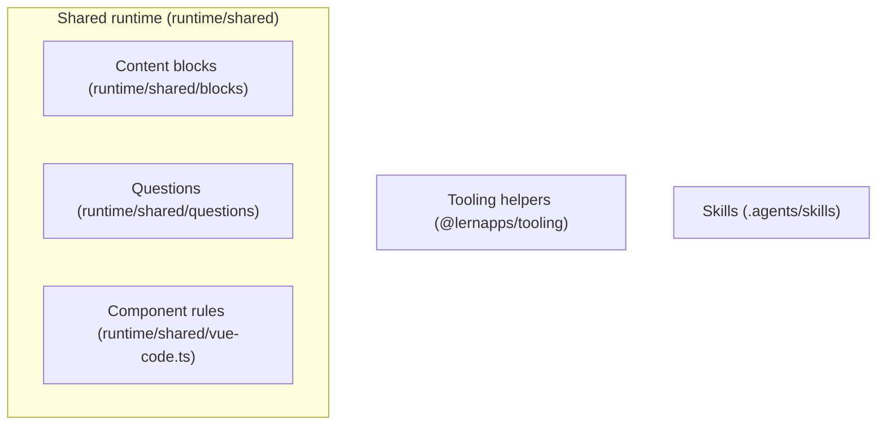
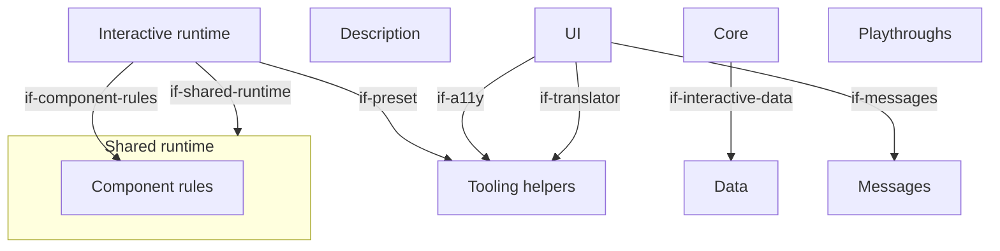
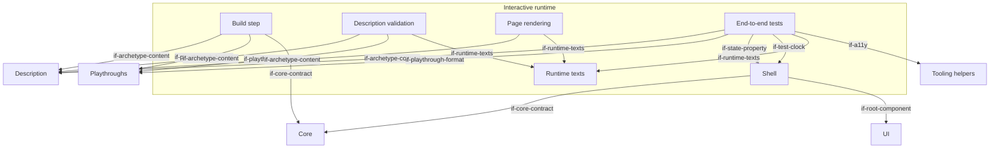
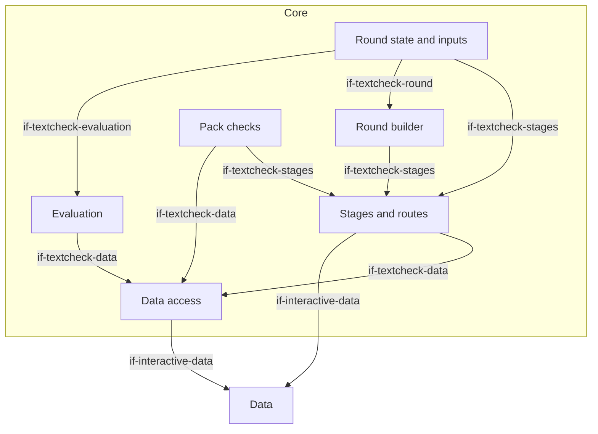
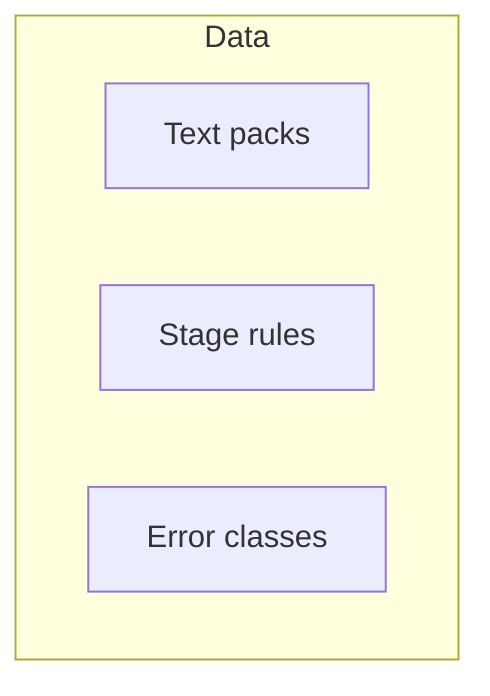

```mermaid
flowchart TB
    subgraph bb-interactive-ui["UI"]
        bb-textcheck-root["Root component"]
        bb-textcheck-choose-page["Choice of the exercise"]
        bb-textcheck-stages-page["Stages page"]
        bb-textcheck-tip-page["Reading tip page"]
        bb-textcheck-round-view["Round view"]
        bb-textcheck-wordlist["Word list"]
        bb-textcheck-result["Result view"]
        bb-textcheck-ui-texts["UI texts"]
        bb-textcheck-controls["Controls"]
        bb-textcheck-reading["Reading values"]
        bb-textcheck-reading-tip["Reading tip texts"]
        bb-textcheck-progress["Stages passed"]
        bb-textcheck-hint-button["Hint button"]
        bb-textcheck-hint-note["Hint note"]
        bb-textcheck-hints["Hint texts"]
    end
    bb-interactive-messages["Messages"]
    bb-textcheck-root -->|"if-textcheck-choose-page"| bb-textcheck-choose-page
    bb-textcheck-root -->|"if-textcheck-stages-page"| bb-textcheck-stages-page
    bb-textcheck-root -->|"if-textcheck-tip-page"| bb-textcheck-tip-page
    bb-textcheck-root -->|"if-textcheck-round-view"| bb-textcheck-round-view
    bb-textcheck-root -->|"if-textcheck-reading"| bb-textcheck-reading
    bb-textcheck-root -->|"if-textcheck-progress"| bb-textcheck-progress
    bb-textcheck-root -->|"if-textcheck-hints"| bb-textcheck-hints
    bb-textcheck-stages-page -->|"if-textcheck-progress"| bb-textcheck-progress
    bb-textcheck-tip-page -->|"if-textcheck-reading-tip"| bb-textcheck-reading-tip
    bb-textcheck-round-view -->|"if-textcheck-reading-tip"| bb-textcheck-reading-tip
    bb-textcheck-round-view -->|"if-textcheck-wordlist"| bb-textcheck-wordlist
    bb-textcheck-round-view -->|"if-textcheck-result"| bb-textcheck-result
    bb-textcheck-round-view -->|"if-textcheck-hint-button"| bb-textcheck-hint-button
    bb-textcheck-round-view -->|"if-textcheck-hint-note"| bb-textcheck-hint-note
    bb-textcheck-round-view -->|"if-textcheck-hints"| bb-textcheck-hints
    bb-textcheck-hint-note -->|"if-textcheck-hints"| bb-textcheck-hints
    bb-textcheck-controls -->|"if-textcheck-reading"| bb-textcheck-reading
    bb-textcheck-reading -->|"if-device-storage"| bb-tooling
    bb-textcheck-progress -->|"if-device-storage"| bb-tooling
    bb-textcheck-root -->|"if-textcheck-ui-texts"| bb-textcheck-ui-texts
    bb-textcheck-ui-texts -->|"if-messages"| bb-interactive-messages
```

# Building Blocks

<!-- From @lernapps/app-templates 5799517 (the generic part and the interactive extension): lernapps update replaces this file except the app sections, between <!-- app: begin … --> and <!-- app: end … -->, which hold the app's own architecture. -->

The generic part has three roots that every app shares, whatever its archetype: the shared runtime of
`@lernapps/app-templates`, the tooling helpers of `@lernapps/tooling` and the skills the app commits. Each archetype's extension adds the rest of
level 1 (`quiz/docs/arc42/`, `explainer/docs/arc42/`, `interactive/docs/arc42/`): its runtime `bb-archetype-runtime`
with the parts `bb-build`, `bb-validation`, `bb-render`, `bb-shell`, `bb-e2e` and `bb-runtime-texts`, which every
extension defines under these ids, and the parts the creator writes, one of which provides `if-archetype-content`.
Parts that only some archetypes have (component rules, question types, tutor handoff, task numbers, exercise contract)
are in the extensions that use them. Not built and not in the frame now: a loading indicator (`dec-no-size-limit`) and
a settings dialog (`dec-no-settings`).

Paths are relative to the root of `lernapps/app-templates`. The parts in a template folder carry their path with the
folder as prefix (`interactive/src/core`); an app that gets this architecture as a copy has them without it
(`src/core`). An app's architecture is this part followed by its archetype's extension, chapter by chapter; so the
level-1 view of a whole app is in its extension.

## Level 1: the generic roots

```arc42
:::diagram
id: building-blocks-generic
view: building-block
notation: mermaid
:::
```



## Shared runtime

Built. The code the archetypes' runtimes share: the page trees, German at the root and every other language below
`/<language>/`, with alternates, a language switch of plain links and the 404 page, which leads every address the
app does not have to its start page (`pages.ts`); learner texts by language (`languages.ts`); the examples check,
which runs an exercise's accepted and rejected examples through the check the page uses, for the quiz and the
explainer (`examples.ts`); the content as YAML, with its problems placed at file, line and path, the errors of a schema
as problems and the checks of the texts (`content.ts`); restricted Markdown and formulas (`text/`); the checks of the
code of Vue components (`vue-code.ts`); HTML escaping (`html.ts`); the frame of every page, with its colours in the light and the dark scheme, its header with the language switch and its footer (`page.css`, `pages.ts`); the content blocks (`blocks/`); the questions, their six types with checker, schema, validation, rendering, engine, end-to-end
helpers and texts, which the quiz and the explainer's exercises both use (`questions/`); Vue at build for the archetypes with components (`vue.ts`); and the app's name, the prefix
of what it stores (`appname.ts`). The app never edits it.

```arc42
:::ignore H014 installed package @lernapps/app-templates (arc42 cannot resolve untracked paths, docToolchain/arc42-language#128)
:::
:::building-block
id: bb-runtime
title: Shared runtime
technology: TypeScript
implements: concept-languages, concept-readable-without-js
:::
```

### Shared runtime modules

The archetype's runtime imports them at build and in its tests.

```arc42
:::ignore H014 installed package @lernapps/app-templates (arc42 cannot resolve untracked paths, docToolchain/arc42-language#128)
:::
:::interface
id: if-shared-runtime
title: Page trees, languages, examples check, Vue at build
provider: bb-runtime
protocol: TypeScript imports (runtime/shared)
:::
```

### Content blocks

Built in the shared runtime, for every archetype that shows content with its questions or on its pages: prose, a
formula, a figure (drawn from data, or a bundled image of `src/images/`), a labelled figure, a table, a quotation and
program code, with the credit of an image or a quotation. Their types, their schema, their checks (what the schema
cannot say, every text complete in the declared languages), their rendering at build and their look; the quiz shows
them as the `material` of a question, the explainer as blocks of a page.

```arc42
:::ignore H014 installed package @lernapps/app-templates (arc42 cannot resolve untracked paths, docToolchain/arc42-language#128)
:::
:::building-block
id: bb-blocks
title: Content blocks
parent: bb-runtime
technology: TypeScript
:::
```

#### Content blocks interface

The validation and the rendering of an archetype with content blocks use their types, checks and renderer.

```arc42
:::ignore H014 installed package @lernapps/app-templates (arc42 cannot resolve untracked paths, docToolchain/arc42-language#128)
:::
:::interface
id: if-blocks
title: The content blocks (checkMaterial, renderMaterial, materialIn)
provider: bb-blocks
protocol: TypeScript imports (runtime/shared/blocks), @lernapps/app-templates/blocks
:::
```

### Questions

Built in the shared runtime, for every archetype that has questions: the six question types and what counts as a right
answer, at build, in the browser and in the tests alike, with their schema, validation, rendering, engine, end-to-end
helpers and texts. The quiz asks them; the explainer's quiz-type exercises and the answers of its generated exercises
use the same. Neither archetype imports the other.

```arc42
:::ignore H014 installed package @lernapps/app-templates (arc42 cannot resolve untracked paths, docToolchain/arc42-language#128)
:::
:::building-block
id: bb-questions
title: Questions
parent: bb-runtime
technology: TypeScript
:::
```

#### Questions interface

The validation, the rendering, the client module and the tests of an archetype with questions use their types,
rendering, engine and checker.

```arc42
:::ignore H014 installed package @lernapps/app-templates (arc42 cannot resolve untracked paths, docToolchain/arc42-language#128)
:::
:::interface
id: if-questions
title: The question types, rendering, engine and checker
provider: bb-questions
protocol: TypeScript imports (runtime/shared/questions), @lernapps/app-templates/questions
:::
```

### Component rules

Built in the shared runtime, for every archetype that has Vue components: code checks on the SFC compiler's output of a
component and the modules of the app it imports (no network, no `eval`, `innerHTML` or `v-html`, imports only from Vue,
the runtime, the storage, i18n and a11y helpers and the app's own modules, never from a URL, browser globals only once
mounted). Which modules are the app's own is the archetype's scope: the explainer's components import their own folder,
the interactive archetype's any file of `src/` and the libraries of its `package.json`.

```arc42
:::ignore H014 installed package @lernapps/app-templates (arc42 cannot resolve untracked paths, docToolchain/arc42-language#128)
:::
:::building-block
id: bb-component-rules
title: Component rules
parent: bb-runtime
technology: TypeScript, Vue SFC compiler
implements: concept-component-rules
:::
```

#### Component rules interface

The validation of an archetype with components runs the checks on its components.

```arc42
:::ignore H014 installed package @lernapps/app-templates (arc42 cannot resolve untracked paths, docToolchain/arc42-language#128)
:::
:::interface
id: if-component-rules
title: The code checks of a component (codeProblems, with the archetype's scope)
provider: bb-component-rules
protocol: TypeScript imports (runtime/shared/vue-code.ts)
:::
```

## Tooling helpers

Built. The parts of `@lernapps/tooling` every app uses, so that rules, helpers and guidance reach the app through
updates without edits: the preset (`archetypes/shared/preset.ts`: lint with the lernapps rules, type check, format,
unit tests, the pre-commit staged files, a build with relative URLs); the lint rules (`lint/rules`: learner texts
German, no request before a click, storage through the wrapper, the Vue component rules); `lernapps check` (`check/`:
accessible, usable at 360 px, no request before a click, no tracking, links and entry links resolve, and the
end-to-end tests before a push); the Playwright configuration (`archetypes/shared/playwright.ts`: Chromium at desktop
width and 360 px on a free port); the small storage (`archetypes/shared/storage.ts`); the announcer and focus helpers
(`archetypes/shared/a11y.ts`); and i18n (`archetypes/shared/i18n.ts`). The skills are a block of their own
(`bb-skills`), which the tooling's `skills/` folder is the source of. A large storage (IndexedDB) is left out (`dec-small-storage`).

```arc42
:::ignore H014 @lernapps/tooling is installed in node_modules (node_modules/@lernapps/tooling), which git does not track, and the validator resolves paths only among tracked files (E011)
:::
:::building-block
id: bb-tooling
title: Tooling helpers
technology: TypeScript, vite-plus, Playwright (@lernapps/tooling, an optional peer of this package)
implements: concept-accessibility, concept-component-rules, concept-device-storage, concept-languages, concept-readable-without-js
:::
```

### Preset interface

The app's vite.config.ts calls `lernapps({ plugins: [<archetype>()] })`; the archetype's runtime uses the preset for
its own Vite servers.

```arc42
:::ignore H014 the interface is in @lernapps/tooling, installed in the untracked node_modules (archetypes/shared/preset.ts)
:::
:::interface
id: if-preset
title: lernapps() preset
provider: bb-tooling
protocol: TypeScript import, @lernapps/tooling/preset
:::
```

### Check command

The creator's assistant, the pre-push hook and CI run `lernapps check`; its report names each rule that failed.
`arc42 validate` in the check is decided, not built.

```arc42
:::ignore H014 the interface is in @lernapps/tooling, installed in the untracked node_modules (check/)
:::
:::interface
id: if-lernapps-check
title: lernapps check command
provider: bb-tooling
protocol: CLI, validation report
:::
```

### Device storage interface

Load, save and remove JSON values through `createStorage`, under the app's prefix in `localStorage`; every access is
wrapped, so the app keeps working when storage is blocked or full. The decided quota of 100 kB per app is not built.

```arc42
:::ignore H014 the interface is in @lernapps/tooling, installed in the untracked node_modules (archetypes/shared/storage.ts)
:::
:::interface
id: if-device-storage
title: createStorage(app)
provider: bb-tooling
protocol: TypeScript import, @lernapps/tooling/storage
:::
```

### Accessibility helpers interface

Announcements through the polite live region, focus moves and the reduced-motion query; the end-to-end tests read the
same live region.

```arc42
:::ignore H014 the interface is in @lernapps/tooling, installed in the untracked node_modules (archetypes/shared/a11y.ts)
:::
:::interface
id: if-a11y
title: announce, moveFocus, prefersReducedMotion
provider: bb-tooling
protocol: TypeScript import, @lernapps/tooling/a11y
:::
```

### Translator interface

Code that shows learner texts gets them through `translator(messages)`, never as strings in code.

```arc42
:::ignore H014 the interface is in @lernapps/tooling, installed in the untracked node_modules (archetypes/shared/i18n.ts)
:::
:::interface
id: if-translator
title: translator(messages)
provider: bb-tooling
protocol: TypeScript import, @lernapps/tooling/i18n
:::
```

## Skills

Built in the tooling, one folder per skill. An app commits its skills under `.agents/skills/`: `lernapps-app` for
every app; the archetype's skill (`lernapps-quiz`, `lernapps-explainer` or `lernapps-interactive`); the content
skills (`lernapps-content-research`, `lernapps-exercise-patterns`, `lernapps-content-growth`); `lernapps-listing`;
and the app's own content guide `app-content`. `lernapps update` installs and replaces the `lernapps-*` skills from
the tooling's `skills/` folder and leaves the app's own alone. They hold the guidance no check can make
(`dec-skill-interface`).

```arc42
:::ignore H014 the skills are committed in each app under .agents/skills; this repository has none
:::
:::building-block
id: bb-skills
title: Skills
technology: Markdown skills (SKILL.md), from the skills/ folder of @lernapps/tooling
implements: concept-low-stimulation
:::
```

### Skills interface

The creator's assistant loads `lernapps-app` when it starts work on an app, and its archetype's skill and the content
skills before it writes what the archetype lets it write.

```arc42
:::ignore H014 the skills are committed in each app under .agents/skills; this repository has none
:::
:::interface
id: if-skills
title: Skill texts (lernapps-app, the archetype's skill, the content skills, app-content)
provider: bb-skills
protocol: Markdown (SKILL.md) loaded by the assistant
:::
```


The interactive archetype's extension of the generic architecture (`docs/arc42/` at the root of
`lernapps/app-templates`): an app whose doing is the content, with a static start page, one app page on which the
shell runs the app's deterministic core and shows its state with the app's Vue components, and hash routes for modes
and levels. The runtime `runtime/interactive/` ships the build step, the pages, the shell and the end-to-end tests; the
creator writes the description, the core, the UI, the data, the messages and the playthroughs, and `src/main.ts`, which
calls `startInteractive`. It reuses the explainer's component rules; the tutor handoff, task numbers, exercise contract
and the examples check are not built for it (its playthroughs take the examples' role). Only the start page reads
without JavaScript. An interactive app adds its own blocks below `bb-interactive-core`, `bb-interactive-ui` and
`bb-interactive-data`: an app gets this architecture as a copy, and writes its own part between the markers
`<!-- app: begin … -->` and `<!-- app: end … -->` in it (here inside the sections of the core, the UI and the data and
at the end of each chapter), which the tooling keeps when it replaces the rest. The creator's assistant follows the
skill `lernapps-interactive` (`if-skills`).

## Level 1 (interactive app)

```arc42
:::diagram
id: building-blocks-interactive-level-1
view: building-block
notation: mermaid
:::
```



## Level 2: the interactive runtime

```arc42
:::diagram
id: building-blocks-interactive-runtime
view: building-block
notation: mermaid
:::
```



## Interactive runtime

Built. The runtime of every interactive app, which the app does not change: it builds the pages, runs the build
checks, starts the app's core and UI in the browser and brings the end-to-end tests.

```arc42
:::ignore H014 installed package @lernapps/app-templates (arc42 cannot resolve untracked paths, docToolchain/arc42-language#128)
:::
:::building-block
id: bb-archetype-runtime
title: Interactive runtime
technology: TypeScript, Vite plugin, Vue
requires: if-shared-runtime, if-preset, if-component-rules
implements: concept-archetype-extension
:::
```

### Build step

Built. The plugin `interactive()` reads `src/app.yaml` and the playthroughs, runs the component rules on the UI, loads
the core in a Vite server of its own and checks its exports and that every route starts, plays every playthrough
against the core twice, each step's inputs through `step` and then its ticks through `tick(state, 20)`, and fails when
the two plays differ or a state differs from the expected one, and only then writes the start page, the app page and
the 404 page. No time passes but the ticks a step names. An app's code has no size limit (`dec-no-size-limit`).

```arc42
:::ignore H014 installed package @lernapps/app-templates (arc42 cannot resolve untracked paths, docToolchain/arc42-language#128)
:::
:::building-block
id: bb-build
title: Build step
parent: bb-archetype-runtime
technology: Vite plugin
requires: if-archetype-content, if-playthrough-format, if-core-contract, if-component-rules
implements: concept-playthroughs, concept-determinism
:::
```

#### Build plugin interface

The app's vite.config.ts adds `interactive()` to the tooling preset; that is the only way the app enters the build.

```arc42
:::ignore H014 installed package @lernapps/app-templates (arc42 cannot resolve untracked paths, docToolchain/arc42-language#128)
:::
:::interface
id: if-build-plugin
title: interactive() Vite plugin
provider: bb-build
protocol: TypeScript import, @lernapps/app-templates/interactive/plugin
:::
```

### Description validation

Built. Validates `src/app.yaml` and every playthrough against their JSON schemas, then German first, complete
languages, unique ids, at least one playthrough, each step expecting something, and known routes; one line per
problem with file and line.

```arc42
:::ignore H014 installed package @lernapps/app-templates (arc42 cannot resolve untracked paths, docToolchain/arc42-language#128)
:::
:::building-block
id: bb-validation
title: Description validation
parent: bb-archetype-runtime
technology: Ajv, JSON Schema, YAML
requires: if-archetype-content, if-playthrough-format, if-runtime-texts
:::
```

### Page rendering

Built. Renders, in each language, the start page (what the app does, the link into the app, the routes, how to play,
competencies, background sections, a `<noscript>` note and no script) and the app page (title, `<noscript>` note with
a link back, the routes as anchor links, and the element the shell mounts into, carrying the route ids).

```arc42
:::ignore H014 installed package @lernapps/app-templates (arc42 cannot resolve untracked paths, docToolchain/arc42-language#128)
:::
:::building-block
id: bb-render
title: Page rendering
parent: bb-archetype-runtime
technology: TypeScript, HTML
requires: if-archetype-content, if-runtime-texts
implements: concept-readable-without-js, concept-hash-routes, concept-accessibility
:::
```

#### Pages interface

Learners, teachers and parents read the start page at `lernapps.net/<repo>/` and play at
`app/?seed=<n>#<route>`; the catalog entry's topics link to the routes.

```arc42
:::ignore H014 installed package @lernapps/app-templates (arc42 cannot resolve untracked paths, docToolchain/arc42-language#128)
:::
:::interface
id: if-pages
title: Start page and app page app/?seed=<n>#<route>
provider: bb-render
protocol: HTML pages over HTTPS (query and hash)
:::
```

### Shell

Built. `startInteractive(core, root)` mounts the root component on the app page and holds the core's state; it takes
the seed from `?seed=<n>` (else a random one) and the route from the hash (else the first route), starts the core
again on a new route, calls `tick(state, 20)` every 20 ms when the core has `tick`, and routes typed inputs to `step`
(`dec-typed-input`): every key typed on the page as a key input, except on links, buttons and form fields or with
Ctrl, Alt or Meta, and every input the root component emits as `input` (an action, or a key it stands for). When the
end-to-end tests' clock is on the page (`if-test-clock`), it starts no interval and steps the ticks the tests ask for.

The app page has a heading line: the h1, the app's title, and a slot beside it, hidden and empty. An app that wants a
small control there (help, sound off) passes a component as `startInteractive(core, App, { title })`; the shell
mounts it into the slot with the props `state` and `lang` and the same `input` event as the root component, and shows
the slot. The header of both pages holds the language switch and nothing else, and an app with one language has none:
the title is the h1, and the way back to the catalog is the platform's. The frame of the header, the page and the
footer is as wide as the custom property `--page-max-width` (default `44rem`), which an app sets in its own
`:root` rule.

```arc42
:::ignore H014 installed package @lernapps/app-templates (arc42 cannot resolve untracked paths, docToolchain/arc42-language#128)
:::
:::building-block
id: bb-shell
title: Shell
parent: bb-archetype-runtime
technology: TypeScript, Vue, DOM events
requires: if-core-contract, if-root-component
implements: concept-core-and-shell, concept-hash-routes, concept-determinism
:::
```

#### Start interface

The app's `src/main.ts` imports the runtime's style, the core and the root component and calls `startInteractive`.

```arc42
:::ignore H014 installed package @lernapps/app-templates (arc42 cannot resolve untracked paths, docToolchain/arc42-language#128)
:::
:::interface
id: if-start
title: startInteractive(core, root, options?)
provider: bb-shell
protocol: TypeScript import, @lernapps/app-templates/interactive
:::
```

#### Test clock

Before the client module runs, the end-to-end tests put an object on the page as the global `lernappsClock`; the
shell then starts no interval and gives that object `tick(count)`, which calls the shell's own tick `count` times. No
time passes in the browser but the ticks a playthrough step names, as in the build. Only the tests set it.

```arc42
:::ignore H014 installed package @lernapps/app-templates (arc42 cannot resolve untracked paths, docToolchain/arc42-language#128)
:::
:::interface
id: if-test-clock
title: lernappsClock, the end-to-end tests' clock
provider: bb-shell
protocol: global object with tick(count)
:::
```

#### State property

The shell mirrors the state on the app's element as `lernappsState`, which the end-to-end tests read.

```arc42
:::ignore H014 installed package @lernapps/app-templates (arc42 cannot resolve untracked paths, docToolchain/arc42-language#128)
:::
:::interface
id: if-state-property
title: lernappsState on the app element
provider: bb-shell
protocol: DOM property
:::
```

### End-to-end tests

Built. `interactiveTests()` checks the start page and the app page without JavaScript in every language and plays
every playthrough's steps in the browser on the test clock (`if-test-clock`): a key input pressed on the keyboard, an
action emitted as `input` by the root component, as the component itself does, then the step's ticks; after each step
it compares the state and the polite announcement, at desktop width and 360 px.

```arc42
:::ignore H014 installed package @lernapps/app-templates (arc42 cannot resolve untracked paths, docToolchain/arc42-language#128)
:::
:::building-block
id: bb-e2e
title: End-to-end tests
parent: bb-archetype-runtime
technology: Playwright
requires: if-archetype-content, if-playthrough-format, if-state-property, if-test-clock, if-runtime-texts, if-a11y
implements: concept-playthroughs
:::
```

#### Tests interface

The app's `e2e/interactive.e2e.ts` only calls `interactiveTests()`.

```arc42
:::ignore H014 installed package @lernapps/app-templates (arc42 cannot resolve untracked paths, docToolchain/arc42-language#128)
:::
:::interface
id: if-e2e-tests
title: interactiveTests()
provider: bb-e2e
protocol: TypeScript import, @lernapps/app-templates/interactive/e2e
:::
```

### Runtime texts

Built. The runtime's own learner texts in German and English; an app may declare only these languages.

```arc42
:::ignore H014 installed package @lernapps/app-templates (arc42 cannot resolve untracked paths, docToolchain/arc42-language#128)
:::
:::building-block
id: bb-runtime-texts
title: Runtime texts
parent: bb-archetype-runtime
technology: JSON per language
implements: concept-languages
:::
```

#### Runtime texts interface

The pages, the validation and the tests take the runtime's texts by key and language.

```arc42
:::ignore H014 installed package @lernapps/app-templates (arc42 cannot resolve untracked paths, docToolchain/arc42-language#128)
:::
:::interface
id: if-runtime-texts
title: Runtime texts by language
provider: bb-runtime-texts
protocol: TypeScript import, JSON
:::
```

## Description

Built in the template: `src/app.yaml` says what the start page shows, the languages and the routes.

```arc42
:::building-block
id: bb-interactive-description
title: Description
technology: YAML
path: src/app.yaml
:::
```

### App description interface

The interactive archetype's content: the build, the validation, the pages and the tests read the app's description
only through this schema.

```arc42
:::ignore H014 installed package @lernapps/app-templates (arc42 cannot resolve untracked paths, docToolchain/arc42-language#128)
:::
:::interface
id: if-archetype-content
title: app.yaml (interactive.v1 schema)
provider: bb-interactive-description
protocol: YAML, JSON Schema
:::
```

## Core

Built in the template. The app's logic, pure TypeScript without DOM, deterministic by its seed, its state plain JSON,
so that it can be played and tested in Node and in the browser alike; it reads the app's data.

```arc42
:::building-block
id: bb-interactive-core
title: Core
technology: TypeScript
requires: if-interactive-data
implements: concept-core-and-shell, concept-determinism
path: src/core
:::
```

### Core contract

The core exports `start(seed, route)`, `step(state, input)` and, when the app moves on its own, `tick(state, dt)`.
The input is typed and extensible (`dec-typed-input`): `{ kind: "key", key }` with the key as `KeyboardEvent.key`, or
`{ kind: "action", name, value? }` for what the learner does with the pointer or by touch; a core handles the kinds it
knows and returns the state unchanged for any other, so new kinds can come.

```arc42
:::ignore H014 installed package @lernapps/app-templates (arc42 cannot resolve untracked paths, docToolchain/arc42-language#128)
:::
:::interface
id: if-core-contract
title: Core contract start, step, tick
provider: bb-interactive-core
protocol: TypeScript module exports
:::
```

<!-- app: begin core -->

### The core's parts

The core builds a round from a text pack, takes the learner's actions and says what was found and what to do next. Its
parts and how they use each other:

```arc42
:::diagram
id: building-blocks-textcheck-core
view: building-block
notation: mermaid
:::
```



### Round state and inputs

Built. `src/core/index.ts` holds the core's contract and its state machine: `start` opens the page or round a route
names (the choice of the exercise, the stages of one, or a round, which begins with the reading tip where its stage has
one), `step` takes the actions of the UI and returns the next state, and `tick` runs the wait before the next hint down;
unknown inputs leave the state as it is. `src/core/types.ts` has the types of the data and of the state.

```arc42
:::building-block
id: bb-textcheck-state
title: Round state and inputs
parent: bb-interactive-core
technology: TypeScript
requires: if-textcheck-stages, if-textcheck-round, if-textcheck-evaluation
path: src/core/index.ts
:::
```

#### Actions interface

The root component hands every action of the learner to `step` as an action input with a name and optionally a value:
`round` (`{ seed, route }`, the round an address names), `language`, `begin` (end the reading tip), `view` (source or
rendition sheet), `toggle`, `move`, `hint`, `clear`, `check` and `again`. The state's phase (`choose`, `stages`, `tip`,
`marking`, `result`) says what the UI shows; the result carries the advice for what to do next.

```arc42
:::interface
id: if-textcheck-actions
title: Learner actions as inputs
provider: bb-textcheck-state
protocol: Typed action inputs (contract.ts); the action round carries { seed, route }
path: src/core/index.ts
:::
```

### Stages and routes

Built. `src/core/stages.ts` knows the routes of the app, the rules and error classes of each stage (cumulative over the
stages before it) and which texts belong to which stage, by measured length and by enough places for the stage's error
classes. The stage cards are derived from the rules and the texts, so that nothing a card says is written out twice.

```arc42
:::building-block
id: bb-textcheck-stages
title: Stages and routes
parent: bb-interactive-core
technology: TypeScript
requires: if-textcheck-data, if-interactive-data
path: src/core/stages.ts
:::
```

#### Stages interface

The state machine, the round builder, the pack checks and the UI ask for the place of a route, the rules and classes of a
stage, the texts that fit it and the cards.

```arc42
:::interface
id: if-textcheck-stages
title: Routes, rules, fitting texts and cards of the stages
provider: bb-textcheck-stages
protocol: TypeScript module exports
path: src/core/stages.ts
:::
```

### Round builder

Built. Picks the text of the stage from the seed, chooses the places to corrupt (a seeded shuffle, at least a few errors
of the classes the stage adds), and splits the rendition into words, each word belonging to the slot it overlaps. It
also finds the sentences the hints may point to: those with an error whose evidence quote stands in the source;
inserted sentences have no quote, so they are never part of a hint. The random numbers come only from the seed
(`src/core/random.ts`), so the same seed gives the same round.

```arc42
:::building-block
id: bb-textcheck-round
title: Round builder
parent: bb-interactive-core
technology: TypeScript
requires: if-textcheck-stages
path: src/core/round.ts
:::
```

#### Round building interface

The state machine builds the round with it; the unit tests call the parts.

```arc42
:::interface
id: if-textcheck-round
title: Round building (buildRound, chooseVariants, hintSentencesOf)
provider: bb-textcheck-round
protocol: TypeScript module exports
path: src/core/round.ts
:::
```

### Evaluation

Built. Counts which errors were found (any marked word of the slot), classifies every word (found, rest of a found
slot, missed, wrongly marked, within the tolerance of a long error in the same sentence) and groups the errors by class.

```arc42
:::building-block
id: bb-textcheck-evaluate
title: Evaluation
parent: bb-interactive-core
technology: TypeScript
requires: if-textcheck-data
path: src/core/evaluate.ts
:::
```

#### Evaluation interface

The state machine asks for the evaluation when the learner checks a round.

```arc42
:::interface
id: if-textcheck-evaluation
title: Evaluation of a round (evaluate)
provider: bb-textcheck-evaluate
protocol: TypeScript module exports
path: src/core/evaluate.ts
:::
```

### Data access

Built. Loads the error classes and every text pack under `src/data/packs/` as JSON modules, in the order of their
paths. A new pack file is found by its place; no code changes.

```arc42
:::building-block
id: bb-textcheck-data-access
title: Data access
parent: bb-interactive-core
technology: TypeScript, Vite glob import
requires: if-interactive-data
path: src/core/data.ts
:::
```

#### Data access interface

The stages, the evaluation and the pack checks read the error classes and the packs only through this module.

```arc42
:::interface
id: if-textcheck-data
title: Packs and error classes
provider: bb-textcheck-data-access
protocol: TypeScript module exports
path: src/core/data.ts
:::
```

### Pack checks

Built. Checks what the JSON schema cannot say: evidence quotes verbatim in the excerpt, every slot exactly once, classes
fitting the language, tolerance only with neighbouring words, enough places for the stages a text belongs to. The unit
tests run it over every pack together with the schema (Ajv).

```arc42
:::building-block
id: bb-textcheck-pack-check
title: Pack checks
parent: bb-interactive-core
technology: TypeScript, Ajv, Vitest
requires: if-textcheck-stages, if-textcheck-data
path: src/core/pack-check.ts
:::
```

#### Pack checks interface

The unit tests call the pack checks for every pack file; whoever writes a pack runs them too.

```arc42
:::interface
id: if-textcheck-pack-check
title: Pack checks (checkPack)
provider: bb-textcheck-pack-check
protocol: TypeScript module exports
path: src/core/pack-check.ts
:::
```

<!-- app: end core -->

## UI

Built in the template. Vue components that show the state and translate the device's input (keys, pointer, touch, …)
into inputs; free in how they render (DOM, SVG, canvas). They may remember something through the small storage; the
template does not.

```arc42
:::building-block
id: bb-interactive-ui
title: UI
technology: Vue single-file components
requires: if-a11y, if-translator, if-messages
implements: concept-component-rules, concept-accessibility
path: src/ui
:::
```

### Root component

The root component takes the props `state` and `lang` and emits `input` with an input (an action, or a key).

```arc42
:::ignore H014 the contract has no file of its own: its props are set in runtime/interactive/interactive.ts (if-start's file), the component is the app's
:::
:::interface
id: if-root-component
title: Root component (state, lang, input)
provider: bb-interactive-ui
protocol: Vue props and events
:::
```

<!-- app: begin ui -->

### The UI's parts

The root component handles the address and shows the page the core's state names; the pages and the round view show
parts of the state; the texts come from the message files through one translator.

```arc42
:::diagram
id: building-blocks-textcheck-ui
view: building-block
notation: mermaid
:::
```



### Root component

Built. `src/ui/App.vue` is only the root: it takes the round from the address (`?seed=<n>#<route>`, the only place the
seed comes from, so that a round can be reloaded and shared), tells the core the page's language, announces every change
through the live region, moves the focus and remembers the stages passed. It shows the page the state's phase names and
holds no state of its own.

```arc42
:::building-block
id: bb-textcheck-root
title: Root component
parent: bb-interactive-ui
technology: Vue single-file component
requires: if-textcheck-choose-page, if-textcheck-stages-page, if-textcheck-tip-page, if-textcheck-round-view, if-textcheck-ui-texts, if-textcheck-reading, if-textcheck-progress, if-textcheck-hints, if-a11y
path: src/ui/App.vue
:::
```

### Choice of the exercise

Built. `src/ui/ChoosePage.vue` is the first page: one card for each kind of exercise, which opens its stages.

```arc42
:::building-block
id: bb-textcheck-choose-page
title: Choice of the exercise
parent: bb-interactive-ui
technology: Vue single-file component
requires: if-textcheck-ui-texts, if-textcheck-stages
path: src/ui/ChoosePage.vue
:::
```

#### Choice interface

The root component gives the page the language as a prop and takes its `open` event (a route) on.

```arc42
:::interface
id: if-textcheck-choose-page
title: Choice page props and open event
provider: bb-textcheck-choose-page
protocol: Vue props and events
path: src/ui/ChoosePage.vue
:::
```

### Stages page

Built. `src/ui/StagesPage.vue` shows the stage cards of one exercise exactly as the core derives them, with a tick on
the stages passed, so that no description of a stage is kept in the UI.

```arc42
:::building-block
id: bb-textcheck-stages-page
title: Stages page
parent: bb-interactive-ui
technology: Vue single-file component
requires: if-textcheck-ui-texts, if-textcheck-progress
path: src/ui/StagesPage.vue
:::
```

#### Stages page interface

The root component gives the page the state and the language as props and takes its `open` event (a route) on.

```arc42
:::interface
id: if-textcheck-stages-page
title: Stages page props and open event
provider: bb-textcheck-stages-page
protocol: Vue props and events
path: src/ui/StagesPage.vue
:::
```

### Reading tip page

Built. `src/ui/TipPage.vue` shows the question of the exercise and the tip on how to read before a round, and sends
`begin` when the learner is ready.

```arc42
:::building-block
id: bb-textcheck-tip-page
title: Reading tip page
parent: bb-interactive-ui
technology: Vue single-file component
requires: if-textcheck-ui-texts, if-textcheck-reading-tip
path: src/ui/TipPage.vue
:::
```

#### Reading tip page interface

The root component gives the page the state and the language as props and takes its `input` and `open` events on.

```arc42
:::interface
id: if-textcheck-tip-page
title: Reading tip page props and events
provider: bb-textcheck-tip-page
protocol: Vue props and events
path: src/ui/TipPage.vue
:::
```

### Round view

Built. `src/ui/RoundView.vue` shows a round: the question, the goal line, the source sheet or the link to the whole
article, the rendition with the word list, the bar below it, and after checking the result. The source and the
rendition are never side by side, so that the learner compares by reading, not by looking across.

```arc42
:::building-block
id: bb-textcheck-round-view
title: Round view
parent: bb-interactive-ui
technology: Vue single-file component
requires: if-textcheck-wordlist, if-textcheck-result, if-textcheck-hint-button, if-textcheck-hint-note, if-textcheck-hints, if-textcheck-reading-tip, if-textcheck-ui-texts
path: src/ui/RoundView.vue
:::
```

#### Round view interface

The root component gives the view the state and the language as props and takes its `input` and `open` events on.

```arc42
:::interface
id: if-textcheck-round-view
title: Round view props and events
provider: bb-textcheck-round-view
protocol: Vue props and events
path: src/ui/RoundView.vue
:::
```

### Word list

Built. `src/ui/WordList.vue` shows the words of the rendition. While marking, they are one listbox with one tab stop: the
arrow keys move between words and sentences, the space bar marks, a tap or click marks. After checking it shows how
each word counts, by colour and line style with a hidden status text for screen readers.

```arc42
:::building-block
id: bb-textcheck-wordlist
title: Word list
parent: bb-interactive-ui
technology: Vue single-file component
requires: if-textcheck-ui-texts
path: src/ui/WordList.vue
:::
```

#### Word list interface

The round view gives the word list the words, the marks, the cursor and the status of each word as props, and takes its
`input` events (toggle and move actions) on.

```arc42
:::interface
id: if-textcheck-wordlist
title: Word list props and input events
provider: bb-textcheck-wordlist
protocol: Vue props and events
path: src/ui/WordList.vue
:::
```

### Result view

Built. `src/ui/ResultView.vue` shows the counts, the errors grouped by class with the explanation, the words marked
wrongly or within tolerance, the legend and the advice: the next stage, another round with a tip for the
class missed, or the other exercise. When every error is found it shows fireworks (no hint taken) or confetti, both calm
and off when the system asks for less motion. It emits the action `again`.

```arc42
:::building-block
id: bb-textcheck-result
title: Result view
parent: bb-interactive-ui
technology: Vue single-file component
requires: if-textcheck-ui-texts
path: src/ui/ResultView.vue
:::
```

#### Result view interface

The round view gives the result view the result and the words as props and takes its `input` and `open` events on.

```arc42
:::interface
id: if-textcheck-result
title: Result view props and events
provider: bb-textcheck-result
protocol: Vue props and events
path: src/ui/ResultView.vue
:::
```

### UI texts

Built. `src/ui/messages.ts` gives the translator of a language over the message file of that language, German for a
language the app does not have yet. A new language is a new complete message file and an entry here.

```arc42
:::building-block
id: bb-textcheck-ui-texts
title: UI texts
parent: bb-interactive-ui
technology: TypeScript
requires: if-messages, if-translator
path: src/ui/messages.ts
:::
```

#### UI texts interface

All components of the UI get their learner texts through this translator and nowhere else.

```arc42
:::interface
id: if-textcheck-ui-texts
title: Translator of a language
provider: bb-textcheck-ui-texts
protocol: TypeScript module export
path: src/ui/messages.ts
:::
```

### Controls

Built. `src/ui/Controls.vue` is what the app puts into the heading line of the page, where the runtime mounts it beside
the h1 (the option `title` of `startInteractive`, in `src/main.ts`): one small button "Schrift", which opens a dialog
with the style of the font, the weight, the size and the line spacing, and a button for the defaults. The texts change
while the learner sets.

```arc42
:::building-block
id: bb-textcheck-controls
title: Controls
parent: bb-interactive-ui
technology: Vue single-file component
requires: if-textcheck-reading, if-textcheck-ui-texts
path: src/ui/Controls.vue
:::
```

#### Controls interface

The runtime mounts the component into the slot of the heading line with the state and the language as props; it takes
nothing else and emits nothing the app uses.

```arc42
:::interface
id: if-textcheck-controls
title: Controls component for the heading slot
provider: bb-textcheck-controls
protocol: Vue props and events, option title of startInteractive
path: src/ui/Controls.vue
:::
```

### Reading values

Built. `src/ui/reading.ts` holds the settings for reading as one shared value, with their limits and defaults, turns
them into CSS custom properties and keeps them on the device through `createStorage("textcheck")`. A saved value that is
out of range or of another shape is ignored; where the browser blocks storage the defaults hold and the settings
work for this visit only. The font itself, Recursive (SIL Open Font License 1.1, with its licence beside it in
`src/ui/fonts/`), is bundled at build time, cut to Latin and the axes weight, MONO and CASL.

```arc42
:::building-block
id: bb-textcheck-reading
title: Reading values
parent: bb-interactive-ui
technology: TypeScript
requires: if-device-storage
path: src/ui/reading.ts
:::
```

#### Reading values interface

The settings are one reactive value that the root component (for the texts) and the controls (for the dialog) share; it is
loaded once, saved after every change and turned into CSS custom properties.

```arc42
:::interface
id: if-textcheck-reading
title: Reading settings, load, save and styleOf
provider: bb-textcheck-reading
protocol: TypeScript module export
path: src/ui/reading.ts
:::
```

### Reading tip texts

Built. `src/ui/reading-tip.ts` turns the rules of a stage into the keys of the question and of the tip lines (all three,
or the last one), so that the tip page and the round view say the same.

```arc42
:::building-block
id: bb-textcheck-reading-tip
title: Reading tip texts
parent: bb-interactive-ui
technology: TypeScript
path: src/ui/reading-tip.ts
:::
```

#### Reading tip texts interface

The tip page and the round view take the question and the tip lines from it.

```arc42
:::interface
id: if-textcheck-reading-tip
title: Question and tip lines of a stage
provider: bb-textcheck-reading-tip
protocol: TypeScript module export
path: src/ui/reading-tip.ts
:::
```

### Stages passed

Built. `src/ui/progress.ts` keeps which stages the learner has passed, so that the cards show a tick. It is the app's
second thing kept on the device, through `createStorage("textcheck")` like the reading settings (100 kB limit); where the
browser blocks storage the ticks hold for this visit only.

```arc42
:::building-block
id: bb-textcheck-progress
title: Stages passed
parent: bb-interactive-ui
technology: TypeScript
requires: if-device-storage
path: src/ui/progress.ts
:::
```

#### Stages passed interface

The root component records a stage as passed when a round is; the stages page reads the list and can clear it.

```arc42
:::interface
id: if-textcheck-progress
title: Stages passed (passed, markPassed, clearPassed)
provider: bb-textcheck-progress
protocol: TypeScript module export
path: src/ui/progress.ts
:::
```

### Hint button

Built. `src/ui/HintButton.vue` is the button that takes the next hint: it is off until the core's wait is over and says
how many seconds are left, and after the last hint it says there are none. It holds no state of its own.

```arc42
:::building-block
id: bb-textcheck-hint-button
title: Hint button
parent: bb-interactive-ui
technology: Vue single-file component
requires: if-textcheck-ui-texts
path: src/ui/HintButton.vue
:::
```

#### Hint button interface

The round view gives the button the state and the language as props and takes its `input` event on.

```arc42
:::interface
id: if-textcheck-hint-button
title: Hint button props and input event
provider: bb-textcheck-hint-button
protocol: Vue props and events
path: src/ui/HintButton.vue
:::
```

### Hint note

Built. `src/ui/HintNote.vue` lists the sentences of the hints taken so far, in the order they were given; they stay on the
page until the round ends. It takes the texts from the hint texts and holds no state of its own.

```arc42
:::building-block
id: bb-textcheck-hint-note
title: Hint note
parent: bb-interactive-ui
technology: Vue single-file component
requires: if-textcheck-hints, if-textcheck-ui-texts
path: src/ui/HintNote.vue
:::
```

#### Hint note interface

The round view gives the note the state and the language as props.

```arc42
:::interface
id: if-textcheck-hint-note
title: Hint note props
provider: bb-textcheck-hint-note
protocol: Vue props
path: src/ui/HintNote.vue
:::
```

### Hint texts

Built. `src/ui/hints.ts` works out from the state what the hints show: the kinds of error of the round (only where the
stage hides them) and the label of each sentence a hint marks. A hint never shows a word and never names an inserted
sentence.

```arc42
:::building-block
id: bb-textcheck-hints
title: Hint texts
parent: bb-interactive-ui
technology: TypeScript
requires: if-textcheck-ui-texts
path: src/ui/hints.ts
:::
```

#### Hint texts interface

The note takes the sentences of the hints from it, the round view the labels of the marked sentences, which it hands to
the list of words as its prop `tags`, and the root component the text of a hint to announce.

```arc42
:::interface
id: if-textcheck-hints
title: Hint texts and tags from the state
provider: bb-textcheck-hints
protocol: TypeScript module export
path: src/ui/hints.ts
:::
```

<!-- app: end ui -->

## Data

Built in the template. The app's content as data in its own format (lessons, texts with their faulty versions).

```arc42
:::building-block
id: bb-interactive-data
title: Data
technology: JSON
path: src/data
:::
```

### App data

The core imports the data files as JSON modules, so they are bundled and checked with the core.

```arc42
:::interface
id: if-interactive-data
title: Data files (JSON imports)
provider: bb-interactive-data
protocol: JSON module import
path: src/data
:::
```

<!-- app: begin data -->

### The data's parts

The data are the text packs, which carry the content, and two tables: the rules of the stages and the error classes. The
core reads all three.

```arc42
:::diagram
id: building-blocks-textcheck-data
view: building-block
notation: mermaid
:::
```



### Text packs

Built. `src/data/packs/<language>/<id>.json`, each a source excerpt, the rendition learners check and the slots with
their correct wording and wrong variants; the schema `src/data/textpack.v1.schema.json` says the format. Which stage a
text belongs to is not written in it but derived from its length and its places for errors. The content guide
`.agents/skills/app-content/SKILL.md` and the skill `app-textpack` say how to write one.

```arc42
:::building-block
id: bb-textcheck-packs
title: Text packs
parent: bb-interactive-data
technology: JSON, JSON Schema
path: src/data/packs
:::
```

#### Text pack format interface

The data access loads every file under `src/data/packs/` and the unit tests check each against the schema.

```arc42
:::interface
id: if-textcheck-pack-format
title: Text pack format (textpack.v1 schema)
provider: bb-textcheck-packs
protocol: JSON, JSON Schema
path: src/data/textpack.v1.schema.json
:::
```

### Stage rules

Built. `src/data/stages.json` holds the rules of the three stages of each kind of exercise: the error classes a stage adds
(stages are cumulative), the errors per round, whether the goal line names the classes, the reading tip, the material
(none, source excerpt, link to the article) and the maximum text length. Rules are data so that changing a stage is not
a code change.

```arc42
:::building-block
id: bb-textcheck-stage-rules
title: Stage rules
parent: bb-interactive-data
technology: JSON
path: src/data/stages.json
:::
```

#### Stage rules interface

The stages module reads the file as a JSON module; the unit tests check its shape.

```arc42
:::interface
id: if-textcheck-stage-rules
title: Stage rules table
provider: bb-textcheck-stage-rules
protocol: JSON module import
path: src/data/stages.json
:::
```

### Error classes

Built. `src/data/error-classes.json` lists the error classes with their status (documented or derived), usual basis,
languages and source.

```arc42
:::building-block
id: bb-textcheck-error-classes
title: Error classes
parent: bb-interactive-data
technology: JSON
path: src/data/error-classes.json
:::
```

#### Error classes interface

The data access reads the table as a JSON module; the rationale page in `src/app.yaml` repeats the class list for
learners and a unit test keeps the two in step.

```arc42
:::interface
id: if-textcheck-error-classes
title: Error classes table
provider: bb-textcheck-error-classes
protocol: JSON module import
path: src/data/error-classes.json
:::
```

<!-- app: end data -->

## Messages

Built in the template. The app's learner texts by language, read through the translator.

```arc42
:::building-block
id: bb-interactive-messages
title: Messages
technology: JSON
implements: concept-languages
path: src/messages
:::
```

### Message files

The UI imports one message file per language and hands it to the translator.

```arc42
:::interface
id: if-messages
title: Message files by language
provider: bb-interactive-messages
protocol: JSON module import
path: src/messages
:::
```

## Playthroughs

Built in the template. Playthroughs as data: a seed, a route and steps of inputs (`keys` as the short form of key
inputs, or `inputs`) and ticks that pass after them, with the state or announcement expected after each step. The
template's playthrough lets a letter go late and starts a round with the action `again`.

```arc42
:::building-block
id: bb-interactive-playthroughs
title: Playthroughs
technology: YAML
implements: concept-playthroughs
path: src/playthroughs
:::
```

### Playthrough format

The build and the end-to-end tests read playthroughs in this format.

```arc42
:::ignore H014 installed package @lernapps/app-templates (arc42 cannot resolve untracked paths, docToolchain/arc42-language#128)
:::
:::interface
id: if-playthrough-format
title: Playthrough (playthrough.v1 schema)
provider: bb-interactive-playthroughs
protocol: YAML, JSON Schema
:::
```

<!-- app: begin -->
<!-- app: end -->
